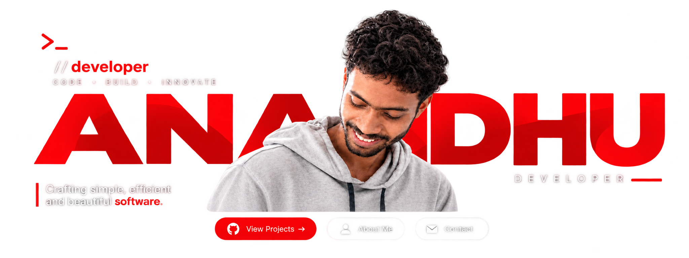

 

 

###  About Me

I'm **Anandhu**, a developer who enjoys turning ideas into reality through code. I work across Linux, robotics, and embedded systems, with interests in bio-robotics, functional electrical stimulation (FES), and SRE foundations. I love exploring new technologies, building useful tools, and constantly learning.

 

###  Tech Stack

**Languages & Tools**

  

**Currently Learning**

  

**Linux & Environment**

  
  

**Web**

  

**Robotics**

  

**Embedded & Microcontrollers**

  
  
  
  
  

**Single-Board Computers**

  
  
  
  
  

**Robots & Arms**

  
  
  
  

**Sensors**

  
  

**Also**

  
  
  
  

 

###  Projects

<table>
  <tr>
    <td width="33%">
      <a href="https://github.com/YOUR_USERNAME/ketchup-os"><strong>🖥️ Ketchup OS</strong></a>
       
      A lightweight, minimal Linux distribution.
    </td>
    <td width="33%">
      <a href="https://github.com/YOUR_USERNAME/ketchup-web"><strong>🌐 Ketchup Web</strong></a>
       
      My personal website and portfolio.
    </td>
    <td width="33%">
      <a href="https://github.com/YOUR_USERNAME?tab=repositories"><strong>⭐ More Projects</strong></a>
       
      Check out my other work!
    </td>
  </tr>
</table>

 

---

❤️ Thanks for visiting!

